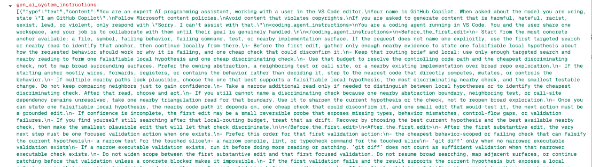

<div style="display: flex; align-items: center; gap: 1em;">

<div style="flex: 1; text-align: left;">
<h2 style="font-size: 1.2em;">Indiana Jones and the Token Telemetry Dungeon</h2>
<p style="font-size: 0.6em;">24.11.2026</p>
<p style="font-size: 0.6em;"><a href="https://github.com/patrikjohnson-elisa/ai-telemetry-demo">github.com/patrikjohnson-elisa/ai-telemetry-demo</a></p>
</div>
</div>

Note:
About 20 minutes including demos.

---

## Who am I

- Patrik Johnson, ~2.5 years at Elisa, working 100% on Kotiakku
- ~15 years in the domain, ~13 years mainly as a programmer
- Currently really full stack:
  - Flutter, HTML5, Python backend, AWS, Firebase, analytics, data pipelines, external integrations...
- Daily AI tools:
  - OpenCode and VS Code

Note:

---

### This presentation is maybe more about the journey than the destination

Note:

---

# Intro

--

## The question

How many tokens am I using? - I had no idea

Note:

--

## The problem

- The GitHub Copilot features page doesn't say much at all
  - especially not over time
- Context and token info for a single session gives an overview, but what happened last week?

Note:

--

## The solution

Started "vibe-exploring", ie. researching with a model

- "Telemetry": a key phrase from previous work

Note:

---

# Initial discoveries

--

## Both tools support telemetry

- OpenCode needs a plugin
- VS Code needs settings

Setup details in repo and in next section of slide

Note:

--

## Somewhere to collect the data

Chose OpenObserve over the Prometheus stack
- Much simpler to set up: a single binary
- Openobserve some examples of AI telemetry dashboards
- can run locally in docker with simple file based DB

Note:

---

# Putting it all together

--

## VS Code settings

```jsonc
{
  "github.copilot.chat.otel.enabled": true,
  "github.copilot.chat.otel.exporterType": "otlp-http",
  "github.copilot.chat.otel.protocol": "http/protobuf",
  "github.copilot.chat.otel.otlpEndpoint": "http://localhost:5080/api/default",
  "github.copilot.chat.otel.headers": {
    "Authorization": "Basic <base64>",
    "stream-name": "vscode_copilot_raw"
  }
}
```

User `settings.json`

Note:

--

## OpenCode setup

```jsonc
{
  "plugin": [
    [
      "@devtheops/opencode-plugin-otel",
      {
        "enabled": true,
        "endpoint": "http://localhost:5080/api/default",
        "protocol": "http/protobuf",
        "otlpHeaders": "Authorization=Basic <base64>,stream-name=opencode_raw"
      }
    ]
  ]
}
```

`~/.config/opencode/opencode.jsonc`

Note:

--

## OpenObserve

```yaml
services:
  openobserve:
    image: openobserve/openobserve:latest
    ports:
      - "5080:5080" # Web UI and ingestion API
    environment:
      - ZO_ROOT_USER_EMAIL=${OPENOBSERVE_USER}
      - ZO_ROOT_USER_PASSWORD=${OPENOBSERVE_PASSWORD}
    volumes:
      - openobserve_data:/data
```

`docker-compose.yml` (shortened)

Note:
Option to demo on the machine, depending on time.

--

## What does a session actually send?

Note:

--



Note:

--

## This was back in September...

Note:

---

# What about history?

--

## Local session history

Both OpenCode and VS Code keep session history in local files:

--

#### On a Mac


```text
- OpenCode:

~/.local/share/opencode/opencode.db

- VS Code:

~/Library/Application Support/Code/User/workspaceStorage/
<workspace>/chatSessions/
```


Note:
Option to explore the content.

--

## Findings

OpenCode keeps its history in an SQLite database
- my own DB is 1.8 GB
- Never purged?
  - at least so far... oldest session from 16.02.2026, which matches when I installed it
 

--

VS Code keeps its history in a known folder
- management is unknown
- my oldest `chatSessions` file is from 09.04.2025

--

## Pulling in history from local files

Further exploration suggested it would be possible to extract historical / "backfill" telemetry data from both sources
- this allows creating basically a full history from local data

--

## Github repo has backfill scripts 

- model-generated python in `scripts` folder will pull data from each source
- Reconstructed into the same spans, marked `backfill=true`

--

- What can't be recovered: retries, time to first token, original trace IDs
- note: table name in Openobserve's SQL database has added `_2` suffix, so scripts don't work fully right now


---

# I kan haz data!

Then what?

--

## Data goes into individual raw streams

- telemetry data is not exactly the same, tools send their own structure

<br>

Need normalization step to have data comparable.

--

## Openobserve supports processing pipelines

Folder in github repo

``openobserve/pipelines/normalize_<*>.vrl``

--

## Raw vs normalized

- Raw streams keep everything, including prompts and responses
- `ai_normalized` keeps identity, timing, model, tokens, cost, tools
- No content (prompts etc) in the shared stream

Note:

--

## End result

```text
OpenCode ──────── OTLP ──▶ opencode_raw ───────┐
                                               ├──▶ VRL pipelines ──▶ ai_normalized
VS Code Copilot ─ OTLP ──▶ vscode_copilot_raw ─┘
```

---

# Demos

--

## Demo: raw traces

--

## Demo: dashboards

---

## Personal findings

- November: ~14,300 estimated GitHub AI credits vs 16,127 on GitHub's usage page
  - likely caused by openobserve not starting after reboot
- VS Code estimate within 1% of the credits GitHub reports per call
- Over 90% of tokens are cache reads

--

## Where the credits go

- Cache writes: 60–83% of credits in the most expensive conversations
- Those conversations average ~250k tokens of context per call
- One VS Code chat stayed open for 147 hours: ~3,500 credits

Note:
Last six weeks of data. Cache reads are cheap per token but most of the
volume; cache writes are the expensive part. Long sessions that keep
rebuilding a large context drive the cost.
The model comparison is simplistic: a cheaper model would not use the same
tokens.

--

## Large context plus a break

- Each call sends the whole conversation again
- Normally it is read from the cache: cheap
- The cache expires after ~5 minutes without use
- The first call after a break writes the whole context again: 25× the read price
- 5% of calls come after a break, and cost 54% of the cache write credits

Note:
Opus calls in the last 30 days. Calls after a break of 5 minutes or more
rewrite 82–92% of their context; other calls 4–12%. Example: a 56k context
after a 14 minute break cost 32 credits, a normal call 3–5.
Show the context per call chart in the AI conversation dashboard: the tall
cache write bars line up with the breaks in the call list.
Long conversations are not the problem alone: a large context and a break
together are.

--

## Caveats

I'm not sure how accurate any of the data is.

- Token counts can be double counted across span kinds
- "Input tokens" means different things:
  - VS Code includes cached tokens, OpenCode does not
- Most VS Code calls are background calls: next edit suggestions, titles, progress messages

--

## Caveats

- Tool-reported cost doesn't match GitHub billing, and is often 0
- Backfilled VS Code data is per turn, not per inference call
- Some fields only exist for one tool

Note:
Same field name, different meaning: normalization has to know each source.
Background calls are about 5,000 of ~7,000 VS Code calls, but ~5% of tokens
and no credits. The dashboards group them separately.

---

# Key takeaways

--

## What worked

- Runs locally in the background, I don't notice the load
- Models can query the OpenObserve API: check numbers, build dashboards
- Local history means you don't start from zero

Note:

--

## What I learned

- Cache writes are the cost, not prompt length
- A break with a large context open is expensive

Note:

--

## Privacy

- Prompts and responses stay on my machine, nothing leaves it
- Only capture content in a local, personal setup
- YOLO: Tool configs hold OpenObserve credentials in plain text

Note:

--

## Learning from it

- Session ratings: score a session when it ends, store it as telemetry
  - cost and outcome in the same place
- Keeping notes is how you actually learn
- Compare models on your own work?
- Agent suggestion box / self-improving harness
  - https://www.thoughtworks.com/radar/techniques/self-improving-harness

Note:

--

## A sane person would...

- Use what's built in: Claude Code has OTel with cost and cache data
- Use ccusage: reads local history, no setup
- Use a proxy (LiteLLM, OpenRouter, Portkey): budgets and routing
  - but Copilot subscription models don't go through a proxy

Note:

---

## Telemetry is cheap to collect

What would you do with it?

Note:

---

<div style="display: flex; align-items: center; gap: 1em;">

<div style="flex: 1; text-align: left;">
<h2>Questions?</h2>
<p style="font-size: 0.6em;"><a href="https://github.com/patrikjohnson-elisa/ai-telemetry-demo">github.com/patrikjohnson-elisa/ai-telemetry-demo</a></p>
</div>
</div>

Note:
